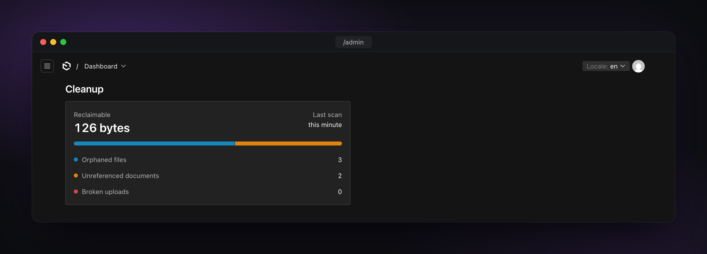
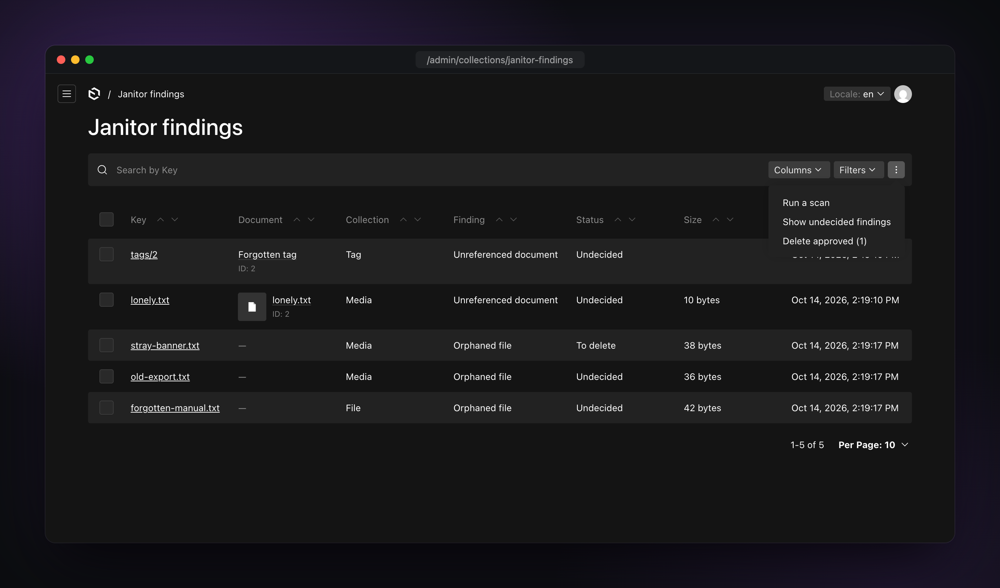
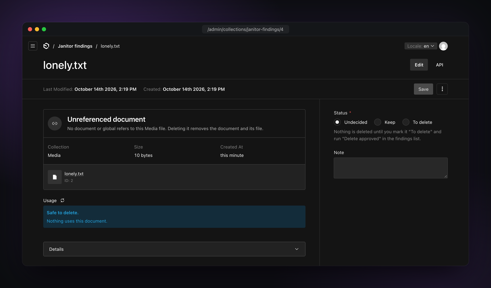
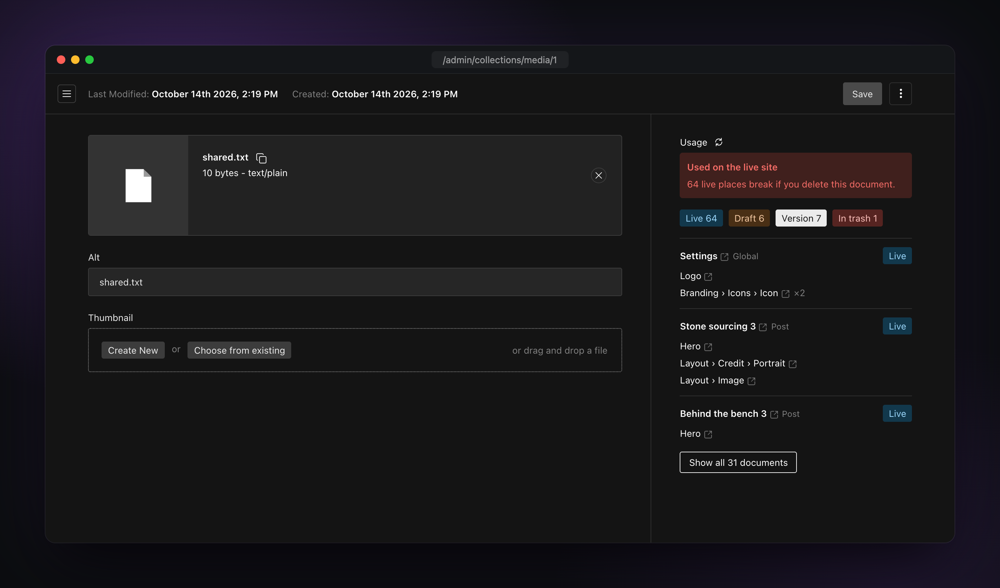
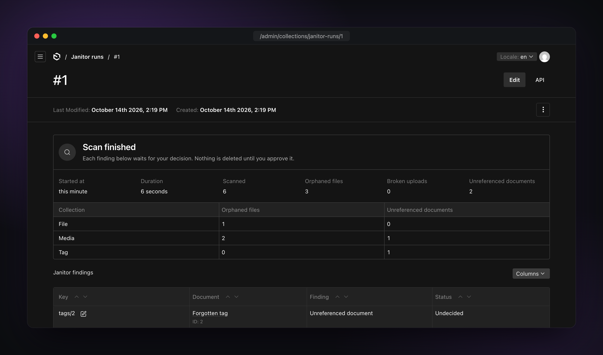

<div align="center">

<picture>
  
</picture>

<h1>Janitor Plugin for Payload</h1>

<p>Housekeeping for Payload: find orphaned files, missing files and unused documents by comparing your storage with your database.</p>

<a href="https://github.com/maximseshuk/payload-plugin-janitor/releases/"></a>
<a href="https://www.npmjs.com/package/@seshuk/payload-plugin-janitor"></a>
<a href="https://www.npmjs.com/package/@seshuk/payload-plugin-janitor"></a>
<a href="https://github.com/maximseshuk/payload-plugin-janitor/actions/workflows/ci.yml"></a>
<a href="https://github.com/maximseshuk/payload-plugin-janitor/blob/main/LICENSE"></a>
<a href="https://ko-fi.com/seshuk"></a>

</div>

## Contents

- **[Getting started](#getting-started):** [Versions](#versions), [Quick start](#quick-start), [How it works](#how-it-works)
- **[Configuration](#configuration):** [Options](#options), [Storage adapters](#storage-adapters), [Access](#access)
- **[Usage detection](#usage-detection):** [References](#references), [Delete guard](#delete-guard), [Usage panel](#usage-panel)
- **[Running and reviewing](#running-and-reviewing):** [Starting runs](#starting-runs), [Findings](#findings), [Admin and endpoints](#admin-and-endpoints)
- **[Recipes](#recipes):** [Media on S3](#media-only-on-s3), [Taxonomies](#taxonomies-only-no-storage), [Two providers](#two-storage-providers-plus-tags-and-categories), [Serverless](#serverless-a-queue-and-an-external-cron), [Headless](#headless)
- **[Troubleshooting](#troubleshooting):** [Startup errors](#startup-errors), [Blind spots](#blind-spots), [Purge results](#purge-results), [Document keys](#document-keys)
- **More:** [Telemetry](#telemetry), [Related plugins](#related-plugins), [Support](#support)

## Features

- **Three kinds of findings.** Orphaned and missing files, plus documents nothing references, in upload or ordinary collections.
- **References from the database.** Foreign keys, `_rels`, JSON, blocks, rich text, globals and versions. Unsure means used.
- **You decide.** A scan only writes findings. Only what you mark is deleted, after a second check.
- **Usage panel and delete guard.** See where a document is used, and block deleting it while it is still used.
- **Any storage.** S3 and S3-compatible, R2, Google Cloud Storage, Azure, Bunny, uploadthing, Vercel Blob or local disk. No extra dependencies.
- **Runs your way.** In the request, as a Payload job, on a cron or from your own code.
- **Admin menu and widget.** Scan and purge from the findings list, in every language Payload ships.
- **Access per action.** Separate rules for reading, approving, scanning and purging.

## Screenshots

The dashboard widget shows what the last scan found and how much space you can free:



The findings list, with the menu that starts a scan or deletes the approved findings:



A finding explains what was found and lets you choose what to do with it:



The usage panel on an upload document lists every place that references it:



A run record shows what a scan found in each collection:



## Getting started

### Versions

| Plugin | Payload | Node.js | Install                               |
| ------ | ------- | ------- | ------------------------------------- |
| 1.x    | 4       | 24.15+  | `@seshuk/payload-plugin-janitor@beta` |
| 0.x    | 3       | 22+     | `@seshuk/payload-plugin-janitor@0`    |

- 1.x is in beta under the `beta` npm tag. Payload 4 is published under `beta` too.
- 1.x needs Payload `4.0.0-beta.0` or later and Next.js 16.4 or later. Canary builds are not supported.
- 0.x needs Payload 3.83 or later.
- Usage detection needs the Postgres, SQLite or MongoDB database adapter.

Once 1.0.0 is stable, `latest` moves to 1.x. 0.x stays available as `@seshuk/payload-plugin-janitor@0` or under the
`latest-0` tag. It gets only critical and high-severity security fixes. See [SECURITY.md](SECURITY.md).

### Quick start

#### Install

```bash
# Payload 4
pnpm add @seshuk/payload-plugin-janitor@beta

# Payload 3
pnpm add @seshuk/payload-plugin-janitor@0
```

#### Configure

```ts
import { s3Storage } from '@payloadcms/storage-s3'
import { janitor } from '@seshuk/payload-plugin-janitor'
import { s3Adapter } from '@seshuk/payload-plugin-janitor/s3'
import { buildConfig } from 'payload'

export default buildConfig({
  plugins: [
    s3Storage({ bucket: 'assets', collections: { media: true }, config: { region: 'eu-central-1' } }),
    janitor({
      collections: { media: true },
      storage: s3Adapter({ bucket: 'assets', config: { region: 'eu-central-1' } }),
    }),
  ],
})
```

Only the collections you list under `collections` are scanned, guarded or get a panel. `media: true` turns on
everything the collection can have: all three checks, the usage panel in the sidebar and the delete guard.

List your storage plugins in `plugins` before `janitor`. See [Plugin order and prefix](#plugin-order-and-prefix).

The plugin adds two collections to the admin, **Janitor findings** and **Janitor runs**, in the `System` nav group.

#### Next steps

1. Run `payload generate:importmap`, so the admin panel can find the plugin's menu, panel and widget.
2. Open **Janitor findings** and choose **Run a scan** from the list menu.
3. Choose **Show undecided findings**. Mark each finding **To delete** or **Keep**, one by one or several at once
   with **Mark selected as "To delete"**.
4. Choose **Delete approved**. The purge checks every finding again and deletes only what passes.

Nothing is deleted before step 4.

### How it works

A scan compares your storage with your database and reports three kinds of findings. In this README, an _ordinary
collection_ is any collection that is not an upload collection.

| Kind      | What it means                                                            | Example                                                                | Can be purged?                                                                 |
| --------- | ------------------------------------------------------------------------ | ---------------------------------------------------------------------- | ------------------------------------------------------------------------------ |
| `orphan`  | A file in storage that no document holds.                                | `media/old-banner.jpg` is in the bucket, but no document names it.     | Yes. The purge deletes the file from storage.                                  |
| `missing` | A document whose file is not in storage.                                 | A `media` document names `photo.jpg`, but the bucket has no such file. | Never. Re-upload the file or delete the document yourself.                     |
| `unused`  | A document that nothing references, in an upload or ordinary collection. | An image no page uses, or a tag no post has.                           | Yes. The purge deletes the document through Payload, or moves it to the trash. |

`orphan` and `missing` need a [storage adapter](#storage-adapters). `unused` works on every listed collection.

A run goes like this:

1. **Scan.** A scan goes through every listed collection and writes what it finds to **Janitor findings**. It never
   deletes anything. Anything younger than `minAge` (24 hours by default) is left out.
2. **Review.** A new finding is **Undecided** (`found`). You mark it **To delete** (`delete`) or **Keep** (`keep`).
3. **Purge.** A purge takes every finding marked `delete` and checks it again right before it acts. See
   [What a purge checks](#what-a-purge-checks).
4. **Delete.** The purge deletes only what passes the check, and sets the finding to `deleted`. A finding that fails
   the check goes to `keep`, with a note that says why.
5. **Rescan.** The next scan updates the facts but keeps your decisions. It removes undecided findings it no longer
   sees. See [Rescans](#rescans).

#### What a scan checks

- **`orphans`** lists the collection's storage under its prefix. It reports every object whose full key no document
  holds.
  - Known keys come from every upload collection in the config, listed or not. They include image size variants
    (`sizes.*.filename`), trashed documents and draft versions.
  - For a collection that is not listed, or whose prefix is unknown, keys are matched by their tail: `a/photo.jpg`
    counts as holding `media/a/photo.jpg`. This can hide an orphan, but it never reports a used file.
- **`missing`** reports every document whose key was not in that listing.
  - A draft that was never published keeps its first file name on the document, even after a later draft replaced
    the file. Such a draft is checked against the file of its latest version instead.
- **`unused`** builds a reverse index of references to the collection's documents. It reports every document with
  none.
  - Trashed documents are skipped.
  - An upload whose file is already missing is reported as `missing` only, not also as `unused`.
  - Sometimes the index cannot be read completely, for example when JSON is nested too deep. The scan then writes no
    `unused` findings for that collection and logs this warning:
    `janitor: usage of "x" could not be read reliably, so no unused findings were written for it`.
  - If usage detection throws, the run fails.

A finding's key (`objectKey`) is the storage key (`media/photo.jpg`) for orphans, missing files and unused uploads.
For a document of an ordinary collection, it is `<slug>/<id>`, for example `tags/12`. How the plugin builds storage
keys is described under [Document keys](#document-keys).

#### What a purge checks

**Orphans.** An orphan is deleted only if all of these are true:

- Its key is inside the collection's prefix.
- No document holds the key now, trashed documents and versions included.
- The object is still there and older than `minAge`.

Right before the delete, the plugin looks up each orphan in storage again on its own (`list` with `keys: [key]`), so
an object written again since the scan is kept. The adapter's `delete` removes the object.

**Unused documents.** An unused document is deleted only if all of these are true:

- It still exists and is the same document the scan saw: its `createdAt` equals the finding's `uploadedAt` (shown as
  **Created at**). An id that a newer document reused is never deleted.
- With `tenants`, it still belongs to the tenants the finding names. See [Multi-tenant](#multi-tenant).
- It is not in the trash.
- Its `updatedAt` is older than `minAge`.
- Nothing references it now.
- No other document holds the same file.

If the collection has Payload's `trash: true`, the document moves to the trash. Otherwise it is deleted, and Payload
and your storage plugin remove its file as on any other delete.

**Missing files.** A `missing` finding is never acted on. You fix it yourself: re-upload the file or delete the
document.

What happens to each finding after a purge is listed under [Purge results](#purge-results).

## Configuration

### Options

| Option                    | Type                                 | Default                             | What it does                                                                                                           |
| ------------------------- | ------------------------------------ | ----------------------------------- | ---------------------------------------------------------------------------------------------------------------------- |
| `enabled`                 | `boolean`                            | `true`                              | `false` switches the plugin off but keeps its schema. See below.                                                       |
| `collections`             | `Record<slug, boolean \| object>`    | required                            | The collections to scan and guard, by slug. `false` skips an entry. See [Per collection](#per-collection).             |
| `storage`                 | `StorageAdapter`                     | none                                | Listing and deletion for every upload collection without its own `storage`. See [Storage adapters](#storage-adapters). |
| `minAge`                  | `number`                             | `86400` (24 hours)                  | Seconds. Anything younger is never reported or deleted. See below.                                                     |
| `jobs`                    | `false \| JobsOptions`               | `false`                             | Run scans and purges inside the request, or queue them as Payload jobs. See [Starting runs](#starting-runs).           |
| `access`                  | `JanitorAccessOptions`               | see [Access](#access)               | Who may read, approve, scan and purge. See [Access](#access).                                                          |
| `tenants`                 | `boolean \| { collection?, field? }` | `false`                             | Findings per tenant, for `@payloadcms/plugin-multi-tenant`. See [Multi-tenant](#multi-tenant).                         |
| `references.ignoreTables` | `string[]`                           | `[]`                                | Tables or collections whose references do not keep a document. See [Reference options](#reference-options).            |
| `references.text`         | `boolean`                            | `false`                             | Also match ids stored whole in text columns. See [Reference options](#reference-options).                              |
| `references.versions`     | `'used' \| 'unused'`                 | `'used'`                            | Whether a reference in an old version keeps a document. See [Reference options](#reference-options).                   |
| `admin`                   | `false \| { group?, widget? }`       | `{ group: 'System', widget: true }` | Findings list menu, nav group and dashboard widget. See [Admin UI](#admin-ui).                                         |
| `endpoints`               | `false \| { path? }`                 | `{ path: '/janitor' }`              | REST routes for scan, purge and the usage panel. See [REST endpoints](#rest-endpoints).                                |
| `overrides`               | `{ findings?, runs? }`               | none                                | Changes to the plugin's two collections. See [Overrides](#overrides).                                                  |
| `telemetry`               | `boolean \| { url? }`                | `true`                              | Anonymous usage telemetry. See [Telemetry](#telemetry).                                                                |

The options types are exported (`JanitorPluginOptions`, `JanitorCollectionOptions`, `JobsOptions`,
`JanitorAccessOptions`, `JanitorTenantsOptions`), so your editor shows the docs for each field.

- **`minAge`.** Objects and documents younger than this are never reported or deleted, because an upload and its
  database row are not written in one step. The value is in seconds and must be `0` or at least `3600`. A value from
  1 to 3599 is most likely meant as hours, so startup rejects it.
- **`enabled: false`.** The plugin is off, but both collections and the `janitor-run` task stay, so the database
  schema does not change and no migration drops the findings. The task does nothing. The plugin adds no routes,
  panels, delete guards, admin UI or startup checks, and sends no telemetry. This is handy per environment:

```ts
janitor({ enabled: process.env.JANITOR !== 'off', collections: { media: true }, storage })
```

#### Per collection

`collections.<slug>` takes `true`, `false` or an object:

| Option              | Type                           | Default                                              | What it does                                                                                                                                           |
| ------------------- | ------------------------------ | ---------------------------------------------------- | ------------------------------------------------------------------------------------------------------------------------------------------------------ |
| `report`            | `boolean \| Check[]`           | `true`                                               | Which checks a scan runs. `false` scans nothing but keeps the panel and the guard. See below.                                                          |
| `usagePanel`        | `boolean \| UsagePanelOptions` | `true` (`false` with `endpoints: false`)             | The "where is this used" panel on the edit view. See [Usage panel](#usage-panel).                                                                      |
| `blockDelete`       | `boolean`                      | `true`                                               | Refuse a delete while something still references the document. See [Delete guard](#delete-guard).                                                      |
| `storage`           | `StorageAdapter`               | the top-level `storage`                              | Listing and deletion for this collection's files. Upload collections only.                                                                             |
| `prefix`            | `string`                       | the storage plugin's `prefix` field default, or `''` | Key prefix inside that storage, without slashes at either end. Upload collections only. See [Plugin order and prefix](#plugin-order-and-prefix).       |
| `compositePrefixes` | `boolean`                      | `false`                                              | The storage plugin runs with `useCompositePrefixes`. Needs `prefix`. Upload collections only. See [Plugin order and prefix](#plugin-order-and-prefix). |

The checks are `'orphans'`, `'missing'` and `'unused'`. What `report: true` (or no `report`) means depends on the
collection:

| Collection               | `report: true` means                 |
| ------------------------ | ------------------------------------ |
| upload with a storage    | `['orphans', 'missing', 'unused']`   |
| upload without a storage | `['unused']`, with a note in the log |
| ordinary collection      | `['unused']`                         |

To leave a check out, use an explicit list. For example, use `report: ['orphans', 'unused']` for a bucket whose
lifecycle rules delete files on purpose.

Trash on purge is not an option. It follows the collection's own Payload `trash` setting.

There is no `defaults` key. To share settings between collections, reuse a JavaScript object:

```ts
const media = { usagePanel: { position: { after: 'alt' }, limit: 5 } } as const

janitor({ collections: { images: media, videos: media }, storage })
```

#### Overrides

`overrides.findings` and `overrides.runs` take Payload collection settings:

- Top-level keys replace the default.
- `access`, `admin` and `labels` are merged one level deep.
- `hooks` are added after the plugin's own hooks of the same kind.
- `slug` renames the collection. Every relation, query and ignored table follows it.
- `fields` is a function that gets the default fields.

```ts
janitor({
  collections: { media: true },
  overrides: {
    findings: {
      slug: 'cleanup-findings',
      admin: { defaultColumns: ['objectKey', 'kind', 'status', 'ticket'] },
      fields: ({ defaultFields }) => [...defaultFields, { name: 'ticket', type: 'text' }],
    },
    runs: { slug: 'cleanup-runs', labels: { plural: 'Cleanup runs', singular: 'Cleanup run' } },
  },
})
```

Keep the fields the plugin reads and writes. If you remove one of them, scans and purges break.

With `tenants`, the plugin adds the tenant scope to the findings `read`, `update` and `delete` access. If you override
one of these in `overrides.findings.access`, your function replaces the tenant scope for that action. Add the scope
yourself if you still need it.

### Storage adapters

Payload's storage plugins can upload and delete files, but none of them can list a bucket. That is why `orphans` and
`missing` need an adapter from this plugin. Each adapter has its own entry point, so only the SDK you use is loaded.
Each one takes a client or binding you have already built.

| Storage                                                                         | Adapter              | Import                                       |
| ------------------------------------------------------------------------------- | -------------------- | -------------------------------------------- |
| `@payloadcms/storage-s3`, and any S3-compatible service (MinIO, Spaces, B2, R2) | `s3Adapter`          | `@seshuk/payload-plugin-janitor/s3`          |
| `@payloadcms/storage-r2`, Cloudflare R2 as a Workers binding                    | `r2Adapter`          | `@seshuk/payload-plugin-janitor/r2`          |
| `@payloadcms/storage-gcs`                                                       | `gcsAdapter`         | `@seshuk/payload-plugin-janitor/gcs`         |
| `@payloadcms/storage-azure`                                                     | `azureAdapter`       | `@seshuk/payload-plugin-janitor/azure`       |
| `@seshuk/payload-storage-bunny`                                                 | `bunnyAdapter`       | `@seshuk/payload-plugin-janitor/bunny`       |
| `@payloadcms/storage-uploadthing`                                               | `uploadthingAdapter` | `@seshuk/payload-plugin-janitor/uploadthing` |
| `@payloadcms/storage-vercel-blob`                                               | `vercelBlobAdapter`  | `@seshuk/payload-plugin-janitor/vercelBlob`  |
| Payload's own disk storage (`staticDir`)                                        | `localAdapter`       | `@seshuk/payload-plugin-janitor/local`       |

```ts
import { S3Client } from '@aws-sdk/client-s3'
import { BlobServiceClient } from '@azure/storage-blob'
import { Storage } from '@google-cloud/storage'
import { del, list } from '@vercel/blob'
import { UTApi } from 'uploadthing/server'

s3Adapter({ bucket: 'assets', config: { region: 'eu-central-1' } })
s3Adapter({ bucket: 'assets', config: { region: 'auto', endpoint: 'https://<account>.r2.cloudflarestorage.com' } })
s3Adapter({ bucket: 'assets', client: new S3Client({ region: 'eu-central-1' }) })
r2Adapter(env.MEDIA)
gcsAdapter(new Storage().bucket('assets'))
azureAdapter(BlobServiceClient.fromConnectionString(connection).getContainerClient('media'))
bunnyAdapter({
  apiKey: process.env.BUNNY_STORAGE_API_KEY!,
  region: 'ny',
  zoneName: process.env.BUNNY_STORAGE_ZONE_NAME!,
})
uploadthingAdapter(new UTApi())
vercelBlobAdapter({ del, list }, { token: process.env.BLOB_READ_WRITE_TOKEN })
localAdapter({ staticDir: 'media' })
```

#### Plugin order and prefix

The plugin reads the key prefix of an upload collection from the `prefix` field that the storage plugin adds. That
field only exists once the storage plugin has run.

- **Plugin order.** List `janitor` after your storage plugins. If `janitor` comes first, startup fails (see
  [Startup errors](#startup-errors)). Passing `prefix` on the collection also fixes this.
- **Composite prefixes.** If the storage plugin runs with `useCompositePrefixes: true`, its `prefix` field has an
  empty default, and the plugin cannot work out the keys from it. Pass the same prefix you gave the storage plugin
  (`''` for none), plus `compositePrefixes: true`. Keys are then `prefix/<document folder>/<filename>`.

A non-empty `prefix` without `compositePrefixes` on such a field stops startup, because the keys it gives would look
exact but still be wrong.

```ts
janitor({
  collections: { media: { prefix: 'media', compositePrefixes: true } },
  storage: s3Adapter({ bucket: 'assets', config: { region: 'eu-central-1' } }),
})
```

#### Adapter details

- **s3**: takes the same `{ bucket, config }` you pass to `s3Storage()`. It builds the client from
  `@aws-sdk/client-s3`, an optional peer dependency.
  - You can pass an existing `S3Client` as `client` instead. The two commands then still load from
    `@aws-sdk/client-s3`.
  - To skip the SDK import entirely, pass `commands: { DeleteObjectCommand, ListObjectsV2Command }` next to
    `client`.
  - A `NoSuchKey`, `NotFound` or 404 on delete counts as already gone.
- **r2**: takes the `R2Bucket` binding.
- **gcs**: takes a `Bucket`.
- **azure**: takes a `ContainerClient`.
- **bunny**: takes the same `storage` object you pass to `bunnyStorage()`: `apiKey`, `zoneName` and the optional
  `region`, with the same names and region codes. Pass the same object: other fields, such as `hostname`, are
  ignored. It walks directories one request at a time and URL-encodes every path segment.
  - It lists the storage zone only. A Bunny Stream video is never listed or deleted by the adapter.
  - A document with `bunnyData.stream.videoId` keeps its video in Stream, not in the zone. So it is never
    reported as `missing`, and it can still be `unused`. Purging it deletes the document through Payload, and
    `@seshuk/payload-storage-bunny` then deletes the video.
- **vercelBlob**: takes `{ del, list }` from `@vercel/blob` and an optional token. It stores the blob URL with the
  finding and uses it for the delete.
- **local**: takes the collection's `staticDir`. When each collection has its own directory, pass a function from
  collection slug to directory instead. With a function, collections never share a scope.
  - Pass the same value the collection uses. A relative path resolves against `process.cwd()`, as in Payload, so an
    absolute path (`path.resolve(dirname, 'media')`) is the safe choice.
  - Payload writes local files flat, so the adapter lists only files directly in that directory (or in its `prefix`
    subdirectory) and ignores deeper subdirectories.
  - It refuses a key that would leave the directory.
  - It reads the whole directory in one page.
- **uploadthing**: takes a `UTApi`. The key is the file name. The adapter stores the uploadthing file key with the
  finding as `ref` and uses it for the delete. See [uploadthing](#uploadthing) for its limits.

#### Listing and lookups

- A listing throws when the provider marks it as truncated but returns no continuation token or cursor (s3, r2,
  vercelBlob).
- An uploadthing page that is empty while more files are reported also throws.
- Vercel Blob and uploadthing page by `hasMore`.

Right before deleting an orphan, the purge looks it up again with `list` and `keys: [key]`. Every bundled adapter
except uploadthing does that with one request per key.

#### uploadthing

uploadthing cannot look up a file by name, so it walks the app's whole file list for every orphan. On a large app, a
purge of many orphans makes many requests.

Its listing pages by offset, so a file uploaded or deleted during a scan can shift a page by one. A file that slips
past this way is reported as `missing` and is never deleted. The next scan sees it again.

> **uploadthing has no prefixes.** The whole app is one flat scope.
>
> - If a collection resolves to a non-empty prefix, the listing throws. Set `prefix: ''`.
> - Several collections on one app see each other's files as one scope. Give them one shared adapter instance. The
>   app is then listed once, and each orphan is reported once (see [Shared scope](#shared-scope)).
> - Files with the same name share one key, so a stray copy of a used file's name is never reported. That can only
>   hide an orphan.

#### Shared scope

A storage scope is one adapter instance plus one prefix. Several listed collections can use the same adapter
instance and the same prefix. The scan then treats them as one scope and uses the union of their keys. An adapter
with `perCollection` set is the exception.

An orphan in a shared scope belongs to the first collection, in the order of `collections`, that reports `orphans`,
so it is written once.

On one adapter, prefixes must be equal or disjoint. Nested or overlapping prefixes stop startup (see
[Startup errors](#startup-errors)).

The plugin matches scopes by adapter instance, not by bucket name. It cannot see that two separately created
adapters point at the same bucket. Keys held by any upload collection still count as known, so nothing is
misreported. But each scope lists the bucket again and reports a true orphan once per collection. Pass one instance,
for example through the top-level `storage`.

#### Writing an adapter

An adapter is an object with two functions. The main entry point exports the types.

```ts
import type { StorageAdapter } from '@seshuk/payload-plugin-janitor'

type StorageObject = {
  /** Full key, prefix included. */
  key: string
  /** When the object was last written. Without it, `minAge` cannot hold the object back. */
  lastModified?: Date
  /** Whatever deleting needs and the key does not carry: a URL, a file id. Stored with the finding. */
  ref?: string
  /** Bytes. Leave it out rather than guess. */
  size?: number
}

type StorageScope = {
  /** Slug of the upload collection. */
  collection: string
  /** Key prefix without a trailing slash. An empty string is the root. */
  prefix: string
}

type StorageListArgs = StorageScope & {
  /** When set, only these keys (all inside `prefix`) are needed. List just them, or ignore the field. */
  keys?: string[]
}

type StorageAdapter = {
  delete: (args: StorageScope & Pick<StorageObject, 'key' | 'ref'>) => Promise<void>
  list: (args: StorageListArgs) => AsyncIterable<StorageObject[]>
  /** Dotted path of a field that marks a document whose file this storage never holds, such as a video in a streaming service. */
  external?: string
  /** The listing depends on `collection`, not only on `prefix`: collections never share a scope. */
  perCollection?: boolean
}
```

Two rules matter:

- **`list` must walk the whole prefix or throw.** A listing that stops short looks like an empty bucket. Every
  document whose file was not reached is then reported as missing.
- **`delete` must resolve when the object is already gone.** If a 404 counts as a failure, the finding waits forever
  for a deletion that cannot happen.

More about `list` and `delete`:

- `list` yields pages, one per provider request, in any order.
- When `keys` is set, the caller filters the result itself, so an adapter may list the whole prefix instead. Every
  key that exists must still come back.
- Both functions take a single object, so later releases can add fields without breaking existing adapters.

### Access

`access` is one function for every action, or an object with one function per action. A missing key gets the
default: a logged-in user of the `admin.user` collection, or any logged-in user when `admin.user` is not set.

| Action    | Covers                                                                                    |
| --------- | ----------------------------------------------------------------------------------------- |
| `read`    | Reading findings and runs, the **Cleanup** widget and the usage route.                    |
| `approve` | Changing a finding's status or note, and deleting findings and runs that are not running. |
| `scan`    | The scan route.                                                                           |
| `purge`   | The purge route. The user also needs `delete` access on the collections it deletes from.  |

```ts
janitor({
  collections: { media: true },
  access: {
    read: ({ req }) => Boolean(req.user),
    approve: ({ req }) => req.user?.role === 'editor' || req.user?.role === 'admin',
    purge: ({ req }) => req.user?.role === 'admin',
  },
})
```

For a purge, the plugin also runs the `delete` access of every listed collection that has findings marked `delete`.
Each must return `true` for the user. `false` or a `Where` query returns `403`. `startJanitor`, `runJanitor` and
`purgeApproved` called from your own code skip both checks.

#### Multi-tenant

With `@payloadcms/plugin-multi-tenant`, set `tenants` to give findings a tenant:

```ts
janitor({
  collections: { media: true, pages: true },
  storage,
  tenants: true,
})
```

| Key          | Type     | Default     | What it does                                        |
| ------------ | -------- | ----------- | --------------------------------------------------- |
| `collection` | `string` | `'tenants'` | Slug of the tenants collection.                     |
| `field`      | `string` | `'tenant'`  | Name of the tenant relationship field on documents. |

`true` uses the multi-tenant plugin's defaults. Pass an object when you renamed its `tenantsSlug` or its tenant field.

Where the tenant comes from:

- A `missing` or `unused` finding takes the tenant of its document at scan time. The finding's **Tenant** field holds
  it.
- An orphan has no document, so it has no tenant.
- A listed collection without the tenant field gives its findings no tenant. Startup logs each such collection.

Who sees what:

- A user who sees every tenant reads and decides every finding. Such a user is one for whom the tenants collection's
  `read` access returns `true`, for example a super admin under `userHasAccessToAllTenants`. A super admin counts only
  when that access returns exactly `true`. If it returns a query, even one that matches every tenant, the user counts
  as a tenant admin and cannot scan or purge.
- Any other user reads, approves and deletes only the findings of the tenants they may read. They never see findings
  without a tenant.
- Runs, the **Cleanup** widget, scans and purges are only for users who see every tenant. For anyone else, the scan
  and purge routes return `403`.
- `access` still applies on top. A user needs both `access` and the tenant check.
- A document can belong to several tenants when the tenant field has `hasMany`. An admin of any one of them can then
  read and approve its finding. A purge still checks the tenants again before it deletes.

When a document moves to another tenant:

- The first scan after `minAge` sets its finding back to `found` and writes the new tenant. A decision made for one
  tenant does not carry over to another one.
- For an `unused` finding, the move changes the document, so scans skip it until it is older than `minAge` again.
  During this window, the finding keeps its old tenant and its decision, and admins of the old tenant still see it.
- A purge checks the tenant again. If the document moved after you marked it `delete`, the purge skips it and sets
  `keep` with the note "the document moved to another tenant".

Findings written before you turned `tenants` on keep their decisions. The next scan fills in their tenant.

Also keep in mind:

- The tenant check trusts the tenants collection's `read` access, and that access can return `true` for users who
  are not super admins:
  - With `useTenantsCollectionAccess: false`, the multi-tenant plugin does not limit the tenants collection. Every
    user it admits counts as seeing every tenant.
  - The multi-tenant plugin limits only users of its admin users collection. A user of another auth collection gets
    the plain access of the tenants collection. If your janitor `access` admits such users, they may see every finding
    and may scan and purge.
- On Postgres and SQLite, `tenants` adds a table for the findings' tenant relation. Create and run a migration.
- A purge needs `delete` access on the target collection to return `true`. The multi-tenant plugin returns a query
  for tenant admins, so only a super admin can purge.
- The `tenant` field counts as a use of a tenant only when the tenants collection itself is listed in `collections`.
- With `blockDelete` on tenant-scoped collections, the guard also runs when the multi-tenant plugin deletes a
  tenant's documents after the tenant itself is deleted. A guard error there can roll back the tenant delete.
- Do not list the plugin's findings and runs collections in the multi-tenant plugin's `collections`.

## Usage detection

### References

Usage detection reads the database, not only the config. A document counts as referenced when its id appears in any
of these:

- foreign keys, including Payload's `_rels` tables and polymorphic relationships;
- ids stored inside JSON: `json` fields, blocks (also with `blocksAsJSON` and block references from `config.blocks`)
  and rich text;
- on MongoDB, any value inside the fields that can hold a reference;
- globals;
- versions and drafts.

Ids are compared as whole values, never as substrings. When in doubt, the plugin counts a document as used.

#### Foreign keys

Foreign keys come from the database catalog: `pg_constraint` on Postgres, `pragma_foreign_key_list` on SQLite. Any
table with a foreign key to the collection counts, your own tables included.

- On Postgres, a database role that owns no table still sees them.
- The plugin looks up the tables in the adapter's `schemaName`.
- When a `relationship` or `upload` field points at the collection but no foreign key to it is visible, usage
  detection throws instead of answering "unused".

#### Reference options

**`references.text`**. Off by default. When on, ids stored whole in plain `text`, `varchar` and `select` columns
count too. This is still a whole-value match: a text field holding `12` matches document `12`, a field holding
`see 12` does not. On MongoDB, `text: true` walks every collection in full instead of only the candidate fields.
This is slower, but never less safe.

**`references.versions`**. With `'used'` (the default), a reference from any version keeps a document. With
`'unused'`, references held only by old versions do not, and such a document is reported as unused. The finding's
`usage` lists the version references, and the findings list shows **Only in old versions**. The latest version of a
document, the current draft included, always counts as live.

**`references.ignoreTables`**. Names whose references do not count, for example an audit log or analytics.

- On Postgres and SQLite, a collection or global slug covers all of that entity's tables: its `_rels`, `_locales`,
  array and block tables and its `_v` version tables.
- On MongoDB, a collection slug covers its collection and its versions collection.
- Any other name must match a table (Postgres, SQLite) or a MongoDB collection exactly.
- The plugin always ignores Payload's locked-documents, migrations, key-value, preferences and jobs tables, and its
  own findings and runs collections.

#### When usage detection throws

Usage detection throws a `janitor:` error whenever it cannot give a sure answer. Examples: a missing foreign key as
above, a transaction whose driver is neither `pg` nor libsql, a document nested too deep on MongoDB.

The plugin never reads such an error as "unused":

- A scan fails.
- A purge stops.
- The delete guard refuses the delete.
- The panel shows an error.

#### How references are read

These details matter if you are tracing why a document counts as used.

<details>
<summary><strong>JSON columns</strong></summary>

On Postgres and SQLite, the plugin reads JSON columns only where a reference can be. For each collection and global,
it finds the top-level fields that can hold one:

- a `relationship` or `upload` field pointing at the collection;
- a `json` or `richText` field;
- a `blocks` field whose blocks it cannot resolve;
- a group, array or named tab with such a field inside.

It reads a JSON column of that entity only when the column belongs to one of those fields:

- Column names are matched by the field name in snake_case.
- Tables renamed with `dbName` are traced back through the adapter's table map.
- Array and block tables of such an entity are read whole.
- A column no field produces, such as one you added by hand, is always read. So is a table Payload did not create,
  such as one of your own.

Reading every JSON column would match numeric ids of one collection against unrelated numbers in another. On
MongoDB, likewise, a collection Payload did not create is read whole.

The plugin reads table suffixes (`versionsSuffix`, `relationshipsSuffix`, `localesSuffix`) from the database
adapter, so custom suffixes work. A table with a suffix it does not recognize reads as an ordinary table. That only
makes more references count.

</details>

<details>
<summary><strong>Lookups for one document</strong></summary>

A lookup for one document (the delete guard, a purge, the panel) first narrows JSON rows in the database. It uses
`strpos` for `jsonb` columns on Postgres and `instr` on SQLite. Rows whose text might hold the id in another form
pass too:

- a long run of digits next to a decimal point (`4.99999999999999999` parses as `5`);
- on SQLite, a backslash escape, an exponent, or a binary JSONB value.

The narrowing only lets extra rows through. The walk described below decides.

A JSON value that cannot be read, such as SQLite's binary JSONB, fails closed. A lookup counts it as a reference,
and the scan writes no `unused` findings for that collection.

</details>

<details>
<summary><strong>How ids are matched</strong></summary>

A reference is found by comparing a value with the id, so a JSON value `12` does count as a reference to document
`12`. That errs on the side of "used", which is the safe side.

Every key of a plain object is read. Rich-text editor nodes are the exception. A node is an object with a string
`type` and a numeric `version`. In a node, plain values under these layout keys are skipped: `colSpan`, `detail`,
`direction`, `format`, `headerState`, `indent`, `mode`, `relationTo`, `rowSpan`, `start`, `style`, `textFormat`,
`textStyle`, `type` and `version`. This way a node's `version: 1` never reads as document `1`.

A few node types have layout keys of their own. Their plain values, or lists of plain values, are skipped:
`listitem.value`, `list.listType` and `list.tag`, `heading.tag`, `table.colWidths`, `table.frozenColumnCount`,
`table.frozenRowCount`, `tablecell.width` and `tablerow.height`.

An object under one of these keys is still read, and so is every other key. An id inside a custom node counts.

JSON is walked 128 levels deep. Anything deeper fails closed:

- A lookup for one document (the delete guard, a purge, the panel) counts it as a reference.
- The scan writes no `unused` findings for that collection and logs a warning.
- On MongoDB, a document nested that deep makes usage detection throw.

</details>

### Delete guard

With `blockDelete` (on by default), a delete fails while the document is still referenced. The error gives the total
number of places that use the document and names up to three of them:

> This document is still used in 3 places, among them &lt;title › field&gt;, ... Remove it there first.

- **The count** covers every place that blocks the delete, including ones the user cannot read.
- **The names** cover only places the deleting user may read. Their titles are read under that user's own access.
  When the user may read none of the places, the message names their collections instead.
- **Without a user**, a delete through the Local API uses the system's access, so every place can be named. A REST
  or GraphQL delete without a user names only the places anyone may read.
- **A place without a title** is named by its collection or global label, in the language of the request, and its
  id.
- **When the places cannot be listed**, the message names the collections, or the tables no collection owns.

The guard follows `references.versions`, like a scan and a purge:

- With `'used'` (the default), a reference from any version blocks the delete.
- With `'unused'`, a reference held only by old versions does not. The latest draft still does.

The guard runs inside the delete's own transaction. When usage detection throws, the delete fails with that error
instead of going through.

`purgeApproved` bypasses the guard, because it has already checked the document again with the same rule. The bypass
is a `context` value that names the exact collection and document being purged, so it covers only that delete. REST
and GraphQL requests cannot set it.

### Usage panel

Each listed collection gets a **Usage** panel on the edit view, unless `usagePanel` is `false`. The panel asks the
server where the document is used right now. It does not depend on scans or findings.

The panel opens with a verdict. Below it, it lists the documents that reference this one: the fields, the locales
and the status (live, draft, version, in trash).

- References that exist only in older versions are grouped under a link that opens those versions. This link works
  in the panel itself and in the "Show all" drawer.
- Each entry links to the document. With `admin` on, the field is highlighted when the document opens.
- A reference from a table no collection owns is listed by table name, without a link.
- The panel lists only places the viewer may read, and reads their titles with the viewer's own access.
- Field labels come in the viewer's language. A reference inside a localized field lists its locale.

#### Verdict

The verdict follows from the places the server lists and its `used` answer:

| Places listed                                 | `used`            | Verdict                                                                          |
| --------------------------------------------- | ----------------- | -------------------------------------------------------------------------------- |
| any published one                             | any               | **Used on the live site.** "N live places break if you delete this document."    |
| drafts or trashed documents, no published one | any               | **Still in use.** "Used by N drafts or trashed documents, so it counts as used." |
| only old versions, or none                    | `true` or missing | **Still in use.** "Older versions still refer to it, so it counts as used."      |
| only old versions                             | `false`           | **Safe to delete.** "Only older versions still hold it."                         |
| none                                          | `false`           | **Safe to delete.** "Nothing uses this document."                                |

The panel says "Safe to delete." only when the server returns `used: false`. With `references.versions: 'used'` (the
default), that means no reference at all.

Two states never read as safe:

- A failed request shows "Could not load usage" with a retry button.
- An unsupported database shows "Usage cannot be checked on this database".

#### Panel options

```ts
janitor({
  collections: {
    media: true,
    banners: { usagePanel: { position: { after: 'alt' }, limit: 5 } },
    icons: { usagePanel: false },
  },
  storage,
})
```

- `position`: `'sidebar'`, `'first'`, `'last'`, `{ after: 'field' }` or `{ before: 'field' }`. Named fields are
  found inside rows, groups, collapsibles and tabs. The default is `'sidebar'`.
- `limit`: how many documents the panel shows before the rest move behind a "Show all" button. The button opens a
  drawer. `0` (the default) shows 3. The drawer always shows all of them, with filters by status.
- `overrides`: Payload field overrides for the panel's `ui` field. `name` and `type` stay as they are.

The panel calls the usage route, so it needs [the endpoints](#rest-endpoints).

#### Placing the panel by hand

Set `usagePanel: false` on the collection and add the field yourself. The collection must still be listed, because
the usage route serves only listed collections. Pass `endpointsPath` if you changed `endpoints.path`.

```ts
import { usageField } from '@seshuk/payload-plugin-janitor'

fields: [{ name: 'alt', type: 'text' }, usageField({ limit: 10 })]
```

In a custom component, use `UsagePanel` from `@seshuk/payload-plugin-janitor/client`. It shows the document being
edited, or any other document when you pass `collectionSlug` and `id`.

## Running and reviewing

### Starting runs

A run is a scan or a purge. Only one runs at a time. The `jobs` option decides where runs happen. It is `false` (the default) or an
object with these keys:

| Key        | Type     | Default     | What it does                                                                          |
| ---------- | -------- | ----------- | ------------------------------------------------------------------------------------- |
| `queue`    | `string` | `'default'` | Payload jobs queue the `janitor-run` task is added to. Something must run that queue. |
| `schedule` | `string` | none        | Cron for a scheduled scan, for example `0 3 * * *`. See [Schedule](#schedule).        |

- **`jobs: false`** (the default). A scan or purge started from the admin UI, the endpoints or `startJanitor` runs
  inside the request. The request waits for the run and gets its result.
- **`jobs: {}`** or **`jobs: { queue }`**. Every run, from the admin UI, the endpoints or `startJanitor`, is queued
  as the Payload job `janitor-run` on `queue` (`'default'` when left out). Something has to run that queue:
  Payload's `jobs.autoRun`, a call to `payload.jobs.run()`, or `GET /api/payload-jobs/run?queue=<queue>`. If nothing
  does, the run never happens.
- **`jobs: { schedule }`**. Also queues a scan on that cron, on the same queue.

On serverless platforms, set `jobs`. An inline run lives only as long as the request. If the request dies, the run
counts as abandoned only after 30 minutes without a heartbeat (see
[Heartbeat and abandoned runs](#heartbeat-and-abandoned-runs)).

#### Schedule

`jobs.schedule` gives the `janitor-run` task a Payload `schedule` that queues a scan on `jobs.queue`.

- Queuing on schedule needs Payload's `jobs.autoRun` or calls to `GET /api/payload-jobs/handle-schedules`.
- Running the queued scan needs the same as any queued run, see above.
- `autoRun` never fires on serverless platforms. There, call both endpoints from an external cron (see
  [the serverless recipe](#serverless-a-queue-and-an-external-cron)).
- Payload's `jobs.access.run` decides who may call them.

```ts
export default buildConfig({
  jobs: {
    autoRun: [{ cron: '*/5 * * * *', queue: 'janitor' }],
  },
  plugins: [
    janitor({
      collections: { media: true },
      storage,
      jobs: { queue: 'janitor', schedule: '0 3 * * *' },
    }),
  ],
})
```

#### From your own code

Both functions take `payload` and a `mode`, `'scan'` (the default) or `'purge'`; any other `mode` throws. Both read
the installed options from `payload`, and both throw `janitor: the plugin is not installed on this Payload config`
when the plugin is missing or has `enabled: false`.

- **`startJanitor(payload, mode?)`** follows `jobs`, the same way the admin button does. With `jobs: false`, it runs
  inside the call. With `jobs` set, it queues the run. It returns a [`StartResult`](#scan-and-purge).
- **`runJanitor(payload, mode?)`** always runs inside the current process and ignores `jobs`. Use it in your own
  scheduler or worker. It returns the scan or purge report, or `null` when another run holds the lock.

```ts
import { runJanitor } from '@seshuk/payload-plugin-janitor'

const report = await runJanitor(payload, 'purge')
```

#### Run records

Every run is recorded in **Janitor runs** with its mode, status (`running`, `done`, `failed`), times, counts and the
error, if any.

- A scan also stores `reclaimableBytes`, the bytes its orphans and unused files hold, for the dashboard widget.
- A purge stores `deleted`, `failed` (the delete or the storage look-up threw) and `skipped` (a check kept the
  finding), plus `freedBytes`. A queued purge has no toast, so these counts are where you see its problems.
- A scan run lists the findings no later run has taken over. A purge run lists the findings that still name it in
  `purgedBy`.
- A count that does not apply to the mode is hidden on the run and empty in the list. A count that is not known yet
  stays empty.

The run edit view opens with a card: what the run did, when it started, how long it took and its counts. Below the
card, a table breaks the run down by collection:

- For a scan, it counts the findings that still name this run, by kind.
- For a purge, it counts the findings that still name this purge: the ones it deleted and the ones it did not
  delete. The **Janitor findings** list below the card shows each of them with its note and, for a failed delete,
  its error.

The table is built from the findings each time you open the run, so it is never stored. The raw fields are in a
collapsed **Details** group.

#### Run lock

- A second start while a run is `running` is refused. The endpoint returns `409` and names the blocking run in
  `blockedBy`.
- Two starts at the same moment never both run. A running run holds a lock in the database: a hidden `lock` field
  with a unique index. A start that cannot take the lock is refused in the same way.
- A run gives the lock back when it finishes, fails or is abandoned.
- On MongoDB, the plugin creates this index itself at startup, even when Payload's own index creation is off.

Known limits of the lock:

- On SQL databases and on a standalone MongoDB server, a queued job that is delivered twice at the very same moment
  can perform its run twice.
- On MongoDB, startup fails when the unique index cannot be built. Some MongoDB-compatible services, such as Cosmos
  DB, build a unique index only on an empty collection.

#### Queued runs

With `jobs` set:

- The start creates the run at once, with status `running`, and then queues the job.
- The response has the `runId`. A job still waiting in the queue blocks a start like a running run.
- The job then performs that same run.
- If queueing the job throws, the run is marked `failed`.
- If the run is no longer `running` when the job starts, for example because it was abandoned, the job starts a new
  run instead.

#### Heartbeat and abandoned runs

A running run records a heartbeat (`heartbeatAt`) as it works, at most once a minute. It records one:

- per page of the storage listing, of documents and of versions;
- while the reverse index is built;
- per finding a purge acts on.

The plugin judges a run by its last heartbeat, or by `startedAt` when it has none. Once that time is more than 30
minutes old, the run counts as abandoned. The next start marks it `failed` with "Abandoned: no sign of life for 30
minutes, so the worker most likely stopped". Then the new run goes ahead.

A queued run gets its heartbeat once, when the start creates it. The heartbeat does not move while the job waits, so
a job that waits more than 30 minutes is abandoned the same way.

### Findings

Each finding is one row in **Janitor findings**, unique on (`collectionSlug`, `objectKey`).

| Field            | Label                | Holds                                                                                                                  |
| ---------------- | -------------------- | ---------------------------------------------------------------------------------------------------------------------- |
| `objectKey`      | Key                  | The storage key, or `<slug>/<id>` for a document of an ordinary collection.                                            |
| `kind`           | Finding              | `orphan`, `missing` or `unused`.                                                                                       |
| `status`         | Status               | `found` (shown as Undecided), `keep`, `delete` (shown as To delete) or `deleted`.                                      |
| `collectionSlug` | Collection           | The collection the finding belongs to, shown by its label.                                                             |
| `documentId`     | Document             | For `missing` and `unused`: the document's title with a link, a thumbnail for uploads, or "Document no longer exists". |
| `tenant`         | Tenant               | With `tenants`: the tenants of the document at scan time. See [Multi-tenant](#multi-tenant).                           |
| `size`           | Size                 | Object or file size in bytes, when known, shown in human-readable units.                                               |
| `uploadedAt`     | Created at           | The object's last-modified time for orphans, the document's creation time for missing and unused.                      |
| `lastSeenAt`     | Last seen at         | When a scan last reported it.                                                                                          |
| `run`            | Found by             | The last scan that reported it.                                                                                        |
| `purgedBy`       | Purged by            | The purge run that acted on it.                                                                                        |
| `usage`          | Usage                | For `unused`, the references that did not count (old versions), shown as "References at scan time".                    |
| `onlyVersions`   | Only in old versions | Computed, not stored, shown for `unused`: every remaining reference is in an old version.                              |
| `purgedAt`       | Deleted at           | When the purge deleted it.                                                                                             |
| `note`           | Note                 | Free text. The purge writes why it kept or skipped a finding.                                                          |
| `error`          | Error                | The error from the last purge whose delete or storage look-up threw. See [Purge results](#purge-results).              |
| `ref`            | hidden               | What the adapter's `delete` needs besides the key, such as a blob URL or a file id.                                    |

An orphan whose `ref` is an http(s) URL shows a link to the file in the **Document** column. A finding with a
document also shows the live usage panel above its stored usage.

#### Status flow

1. A scan creates the finding as `found`.
2. An admin sets it to `delete` or `keep`.
3. A purge takes `delete` findings. It sets `deleted`, or `keep` with a note when the second check fails.

Who can change what:

- Only the plugin sets `deleted` (a purge) or moves a finding away from it (a scan that sees it again). A user write
  that does either is rejected with a validation error in the user's language.
- You can edit only `status` and `note`. Every other field has `access.update` set to `false`, and only the plugin
  writes it.
- Findings cannot be created through the API.
- Users that pass `access.read` can read findings. Users that pass `access.approve` can delete them.

#### Rescans

A rescan never overrides your decision about the same facts:

- For a finding it sees again, a scan updates the last seen time and the run. It updates the size, creation time and
  usage only while the finding is still `found`.
- It leaves `keep` and `delete` alone. A finding goes back to `found` only when the facts behind the decision
  changed: its kind or its `documentId` is different now, its document moved to another tenant, or it was `deleted`
  and the scan sees it again.
- It removes `found` findings it no longer sees, but only for the kinds and collections that run actually checked. A
  scan never removes decided findings.

### Admin and endpoints

#### Admin UI

| Key      | Type              | Default    | What it does                                                                                                     |
| -------- | ----------------- | ---------- | ---------------------------------------------------------------------------------------------------------------- |
| `group`  | `false \| string` | `'System'` | Nav group of **Janitor findings** and **Janitor runs**. `false` keeps them out of the nav, but their pages stay. |
| `widget` | `boolean`         | `true`     | The **Cleanup** dashboard widget.                                                                                |

With `admin` on (the default), the plugin mounts:

- Items in the findings list menu:
  - **Run a scan**.
  - **Show undecided findings**: the list filtered to status `found`.
  - **Mark selected as "Undecided"**, **"Keep"** and **"To delete" (N)**: shown while rows are selected, for users
    who may change findings. Deleted findings in the selection are left as they are.
  - **Delete approved (N)**: N counts the findings marked `delete` that a purge can delete. `missing` findings are
    left out, because there is no file to delete. The item is disabled at 0. It asks you to confirm before the purge
    starts. A `missing` finding stays editable, and its status field says why marking it `delete` deletes nothing.
- A finding edit view:
  - A card at the top says in plain words what was found. It shows the collection, the size, when it was found and a
    link to the file or document.
  - Status and note sit in the sidebar. The status offers **Undecided**, **Keep** and **To delete**.
  - **Deleted** is never offered: only a purge sets it, and a deleted finding's status is read-only.
  - The raw facts (object key, ids, dates, run) are in a collapsed **Details** group.
- A run edit view with a summary card and a per-collection table (see [Run records](#run-records)).
- A provider that highlights a field when the panel links to it.
- **Janitor findings** and **Janitor runs** in the `admin.group` nav group.
- A **Cleanup** dashboard widget (slug `janitor`) with the result of the last finished scan:
  - orphaned files, unreferenced documents and broken uploads, with a bar that shows each kind's share;
  - the bytes a purge of the orphans and unused documents would free;
  - when the scan finished;
  - a link from each kind with findings to its list of findings.

`admin: { group: false }` keeps the two collections out of the nav, but their list and edit pages stay, so the
widget's links still open. `admin: false` hides both collections and leaves out the menu, the provider and the
widget.

About the widget:

- It only reads the runs collection. It never starts a scan. Before the first scan, it shows zeros, **Not yet** as
  the scan time and a link to the findings list.
- It renders nothing for a user who cannot read the findings, so it follows `access`.
- Registering it only adds it to the dashboard's **Add +** list. You can size it from `small` to `medium`.
- The plugin does not touch `admin.dashboard.defaultLayout`.

After a run, the menu shows a toast with an **Open runs** button. The toast shows one of these:

- the scan's counts of orphans, missing and unused;
- the purge's failed and skipped findings;
- the server's error text.

To approve many findings at once:

1. Click **Show undecided findings**.
2. Select the rows, or select all.
3. Open the menu and click **Mark selected as "To delete"**.
4. Click **Delete approved**.

#### REST endpoints

| Key    | Type     | Default      | What it does                                                                                                |
| ------ | -------- | ------------ | ----------------------------------------------------------------------------------------------------------- |
| `path` | `string` | `'/janitor'` | Base path under Payload's API route (`/api` by default). Must start with `/`. Trailing slashes are removed. |

With `endpoints` on (the default), the plugin adds these routes:

| Method | Path                                 | Access                                           | What it does                                                                     |
| ------ | ------------------------------------ | ------------------------------------------------ | -------------------------------------------------------------------------------- |
| `POST` | `/api/janitor/scan`                  | `scan`                                           | Starts a scan, in the request or as a job (see [Starting runs](#starting-runs)). |
| `POST` | `/api/janitor/purge`                 | `purge`, plus `delete` on the target collections | Starts a purge, in the request or as a job.                                      |
| `GET`  | `/api/janitor/usage/:collection/:id` | `read`, plus read access to the document         | Where a document is used, for the panel.                                         |

When the access action denies the request, the route returns `403 { "error": "Forbidden" }`.

**`endpoints: false`** registers no routes. The admin UI and the usage panel call these routes:

- `endpoints: false` needs `admin: false` too.
- The usage panel is then off by default. Turning it on (`usagePanel: true` or an object) is rejected at startup.

Each route carries an OpenAPI operation in `custom.openapi`. With
[@seshuk/payload-plugin-openapi](https://github.com/maximseshuk/payload-plugin-openapi) installed, they show up in
your API docs.

##### Scan and purge

`scan` and `purge` return:

- `200` with a `StartResult`;
- `409` when a run is already going;
- `500` when starting or running fails.

```ts
type StartResult = {
  blockedBy?: {
    heartbeatAt?: string
    id: number | string
    mode?: 'purge' | 'scan'
    staleAt: string
    startedAt?: string
  }
  error?: string
  jobId?: number | string
  queued: boolean
  reason?: 'already-running'
  report?: { deleted: number; failed: number; skipped: number }
  runId?: number | string
  scan?: { missing: number; orphans: number; unused: number }
  started: boolean
}
```

| `jobs`         | `200` body                                                                                                |
| -------------- | --------------------------------------------------------------------------------------------------------- |
| `false`, scan  | `{ "queued": false, "runId": 7, "scan": { "missing": 0, "orphans": 3, "unused": 1 }, "started": true }`   |
| `false`, purge | `{ "queued": false, "report": { "deleted": 4, "failed": 0, "skipped": 1 }, "runId": 8, "started": true }` |
| set            | `{ "jobId": 12, "queued": true, "runId": 9, "started": true }`                                            |

- With `jobs: false`, `runId` is the run that just finished. With `jobs` set, `runId` is the run the job will
  perform.
- `scan` gives the scan's counts.
- `report` says how many findings the purge deleted, failed and skipped.

The `409` body is `{ "blockedBy": { ... }, "queued": false, "reason": "already-running", "started": false }`.
`blockedBy` describes the blocking run: its id, mode, start, last heartbeat, and `staleAt`, when it counts as
abandoned.

When the start or an inline run throws, the route returns `500` with
`{ "error": "<message>", "queued": false, "started": false }`. An inline run is marked `failed` first. When an
access function throws, the response is Payload's own `{ "errors": [{ "message": "…" }] }`.

##### Usage

`usage` returns `{ "supported": true, "usage": UsageHit[], "used": boolean }`.

- `used` is the answer a purge's usage check would give: whether any reference keeps the document under the
  configured `references.versions`.
- `usage` lists every place, current documents first, then the most recently updated.
- `?limit=N` returns only the first N entries. `used` still considers every reference, including ones not listed.
- It lists only places the requesting user may read, with titles read under the same access. Field labels come in
  the request's language.

Other responses:

- `404` with `{ "error": "Not found" }` when the document does not exist or the user may not read it.
- `{ "supported": false, "usage": [] }` on a database without usage detection.
- `400` with `{ "error": "Missing parameters" }` or `{ "error": "Collection is not watched" }`.
- When usage detection or an access function throws, the request fails with Payload's own
  `{ "errors": [{ "message": "…" }] }`.

```ts
type UsageHit = {
  anchor?: string
  autosave?: boolean
  collection: string
  count: number
  fields: string[]
  global: boolean
  id?: number | string
  locales?: string[]
  status: 'draft' | 'published' | 'trashed' | 'version'
  title?: string
  updatedAt?: string
  url?: string
  versionId?: number | string
}
```

## Recipes

### Media only, on S3

```ts
janitor({
  collections: { media: true },
  storage: s3Adapter({ bucket: 'assets', config: { region: 'eu-central-1' } }),
})
```

### Taxonomies only, no storage

```ts
janitor({
  collections: { tags: true, categories: true, authors: { report: false } },
})
```

`tags` and `categories` are ordinary collections, so `true` means the `unused` check, the panel and the guard.
`authors` is never scanned, but it keeps the panel and the guard.

### Two storage providers, plus tags and categories

```ts
const images = { bucket: 'images', config: { region: 'eu-central-1' } }
const bunny = {
  apiKey: process.env.BUNNY_STORAGE_API_KEY!,
  hostname: process.env.BUNNY_STORAGE_HOSTNAME!,
  zoneName: process.env.BUNNY_STORAGE_ZONE_NAME!,
}

export default buildConfig({
  // ...
  plugins: [
    s3Storage({ ...images, collections: { media: { prefix: 'media' } } }),
    bunnyStorage({ collections: { documents: { prefix: 'docs' } }, storage: bunny }),
    janitor({
      collections: {
        media: { storage: s3Adapter(images) },
        documents: { storage: bunnyAdapter(bunny) },
        tags: true,
        categories: { blockDelete: false },
      },
      references: { ignoreTables: ['audit_log'], text: true },
      minAge: 172_800,
    }),
  ],
})
```

Each adapter takes the same options as its storage plugin, so one object serves both.

### Serverless: a queue and an external cron

```ts
janitor({
  collections: { media: true, tags: true },
  storage: s3Adapter({ bucket: 'assets', config: { region: 'eu-central-1' } }),
  jobs: { queue: 'janitor', schedule: '0 3 * * *' },
})
```

Every scan and purge now runs as a Payload job on the `janitor` queue, and a scan is queued every night at 3:00.
Have an external cron call two endpoints:

- `GET /api/payload-jobs/handle-schedules` queues the scheduled scan when it is due.
- `GET /api/payload-jobs/run?queue=janitor` runs the queued jobs, including runs started from the admin.

Payload's `jobs.access.run` decides who may call them. Without Payload's `jobs.autoRun`, startup logs a warning about
`jobs.schedule` (see [Log messages](#log-messages)). Here the external cron does that work, so the warning is
expected.

### Headless

```ts
janitor({
  collections: { media: true, tags: true },
  storage: localAdapter({ staticDir: (slug) => path.resolve(dirname, 'uploads', slug) }),
  admin: false,
  endpoints: false,
})
```

The plugin mounts nothing in the admin, registers no routes and shows no usage panel. Start runs from a script:

```ts
import { startJanitor } from '@seshuk/payload-plugin-janitor'

await startJanitor(payload)
await startJanitor(payload, 'purge')
```

## Troubleshooting

### Startup errors

#### When the config is built

The plugin checks its options when the config is built. These errors stop Payload from starting:

| Message starts with                                                                                       | What to do                                                                                                    |
| --------------------------------------------------------------------------------------------------------- | ------------------------------------------------------------------------------------------------------------- |
| `janitor: no collection listed`                                                                           | List at least one collection, or set `enabled: false` to switch the plugin off.                               |
| `janitor: collection "x" does not exist`                                                                  | Fix the slug.                                                                                                 |
| `janitor: "janitor-findings" is the plugin's own collection and cannot be watched`                        | Remove the plugin's own collections from `collections`.                                                       |
| ``janitor: "x" is not an upload collection; only `unused` can be reported for it``                        | Drop `orphans` and `missing` from `report` for ordinary collections.                                          |
| ``janitor: "x" is not an upload collection; `storage`, `prefix` and `compositePrefixes` do not apply``    | Remove `storage`, `prefix` and `compositePrefixes` from ordinary collections.                                 |
| `` janitor: "x" has `compositePrefixes` but no `prefix` ``                                                | Pass the prefix the storage plugin was given, `''` for none.                                                  |
| ``janitor: "x" has a `prefix` field with an empty default, so its keys are unknown``                      | Pass `prefix` on the collection, and `compositePrefixes: true` if the storage plugin uses composite prefixes. |
| ``janitor: "x" is given `prefix: "..."`, but its `prefix` field has an empty default``                    | Add `compositePrefixes: true` if the storage plugin uses composite prefixes, or pass `prefix: ""`.            |
| ``janitor: "x" has `compositePrefixes`, but its `prefix` field defaults to "..."``                        | The storage plugin does not use composite prefixes. Drop `compositePrefixes`.                                 |
| ``janitor: "x" has `timestamps: false`, so an unused document can be neither aged nor re-checked``        | Drop `unused` from `report` (`report: false` for an ordinary collection) or turn timestamps on.               |
| `janitor: "x" reports orphans and missing objects but has no storage`                                     | Pass `storage` on the collection or at the top level, or remove those checks from `report`.                   |
| `janitor: "x" has an unknown check "..."` / `has a duplicate check`                                       | Use each of `missing`, `orphans`, `unused` at most once.                                                      |
| `janitor: "x" has nothing switched on`                                                                    | `report: false`, `usagePanel: false` and `blockDelete: false` together leave nothing to do.                   |
| `janitor: "x" cannot place the usage panel: Field path "alt" not found`                                   | `usagePanel.position` names a field that does not exist, including inside tabs, rows and groups.              |
| `janitor: "x" cannot place the usage panel: Field path "alt" is ambiguous, use the full path: …`          | Two fields share that name in different groups or tabs. Give the dotted path, such as `meta.alt`.             |
| ``janitor: `storage` is set but no listed collection is an upload collection``                            | Remove the top-level `storage` or list an upload collection.                                                  |
| `janitor: the admin UI needs the REST endpoints`                                                          | With `endpoints: false`, also set `admin: false`.                                                             |
| `janitor: "x" has a usage panel, which needs the REST endpoints`                                          | With `endpoints: false`, drop `usagePanel` from that collection or set it to `false`.                         |
| ``janitor: `endpoints.path` must start with "/"``                                                         | Start the path with `/` and leave out whitespace.                                                             |
| ``janitor: `endpoints.path` must name a path under /api, such as "/janitor"``                             | The path is only slashes. Pass a path such as `/janitor`.                                                     |
| ``janitor: `jobs` must be `false` or an object``                                                          | Pass `false`, or an object such as `{ queue: 'janitor' }`.                                                    |
| ``janitor: `jobs.queue` must name a queue``                                                               | Give the queue a non-empty name, or leave it out for `'default'`.                                             |
| ``janitor: `jobs.schedule` must be a cron expression``                                                    | Pass a cron string, for example `0 3 * * *`.                                                                  |
| ``janitor: `minAge` must be a number of seconds, 0 or more``                                              | Use a finite number of seconds, 0 or more.                                                                    |
| ``janitor: `minAge` is in seconds and must be 0 or at least 3600``                                        | The value looks like hours. Multiply it by 3600, for example `86_400` for 24 hours.                           |
| ``janitor: `references.versions` must be "used" or "unused"``                                             | Use one of the two values.                                                                                    |
| ``janitor: `tenants` must be `true`, `false` or an object``                                               | Pass `true`, or an object such as `{ collection: 'sites' }`.                                                  |
| ``janitor: `tenants.collection` must name a collection`` / ``janitor: `tenants.field` must name a field`` | Give a non-empty slug and field name, or leave them out for the defaults.                                     |
| ``janitor: `tenants.collection` "janitor-runs" is the plugin's own collection``                           | Name the tenants collection of the multi-tenant plugin.                                                       |
| ``janitor: `tenants.collection` "sites" is not a collection in the config``                               | Add the tenants collection, fix `tenants.collection`, or list janitor after the plugin that adds it.          |
| `janitor: "a" and "b" share storage with nested prefixes "" and "media"`                                  | Give both the same prefix to share one scope, or prefixes that do not contain each other.                     |

Notes on two of these errors:

- **Nested prefixes** (the last row). It comes up for two collections on the same adapter instance whose prefixes
  contain each other, such as `''` and `media`, or `media` and `media/thumbs`. The full message ends with
  `; give them the same prefix or separate ones`. An adapter with `perCollection` set (for example `localAdapter`
  with a `staticDir` function) keeps every collection apart, so it never causes this error.
- **Empty-default `prefix`**. It comes up for a collection that reports `orphans` or `missing` without an explicit
  `prefix`, when its storage plugin's `prefix` field defaults to `''`. With `useCompositePrefixes` or
  `alwaysInsertFields`, that field no longer says where the files are.

#### In `onInit`

These errors stop startup in `onInit`, once the final config and the database adapter are known:

- `janitor: usage detection needs the Postgres, SQLite or MongoDB adapter; "x" cannot be checked`. Any listed
  collection needs usage detection (`unused`, the panel or the guard), and the database is something else.
  `blockDelete` and `usagePanel` are on by default, so this covers almost every setup.
- `janitor: "x" stores files under "media" but janitor read "" before its storage plugin ran`. `janitor` was listed
  before the storage plugin that adds the `prefix` field. Move it after the storage plugins in `plugins`, or pass
  `prefix` on the collection.
- The three `prefix` field errors above (the two empty-default ones and the `compositePrefixes` one). The storage
  plugin added that field after `janitor` ran.
- ``janitor: `tenants` is on, but no listed collection has a `tenant` relationship to "tenants"``. No listed
  collection has the tenant field. Check that the multi-tenant plugin is set up and lists those collections, and that
  `tenants.collection` and `tenants.field` match its settings.
- `janitor: cannot create the unique index on "janitor-runs.lock" that the run lock needs`. On MongoDB, the index
  for the run lock cannot be created, for example because the user has no right to create indexes.

#### Log messages

Three messages are only logged in `onInit`:

- Info: ``janitor: "media" has no storage, so only `unused` is reported`` for an upload collection without a
  storage.
- Info: ``janitor: "tags" has no `tenant` field, so its findings are visible only to users who see every tenant``
  with `tenants`, for a listed collection without the tenant field.
- Warning:
  ``janitor: `jobs.schedule` queues a scan but nothing runs the "<queue>" queue; set Payload's `jobs.autoRun` or call GET /api/payload-jobs/handle-schedules and /run from outside``
  when `jobs.schedule` is set and Payload's `jobs.autoRun` is not.

### Blind spots

The plugin only knows what the database and storage tell it. It cannot see:

- References held outside the database: other sites, emails, CDN caches, hard-coded URLs in your code or templates.
- Ids inside longer strings or URLs, such as `/media/12/photo.jpg` or `see 12`. These are never matched.
- References by slug, filename or URL instead of by id, such as a link field holding `/blog/my-post`.
- An id kept in a plain `number` field. On Postgres and SQLite, number columns are never read, because widths,
  prices and counts would match ids and keep unrelated documents alive.
- An id that is the whole value of a `json` field, such as `12` or `"abc"`. On Postgres and SQLite, only ids inside
  a JSON object or array are read, for the same reason.
- Files other plugins write next to the uploads, such as blurhash images or video thumbnails, that no upload
  document names in `filename` or `sizes`. They are reported as orphans.
- A table of your own with a foreign key to a listed collection counts. But the panel lists it by table name and
  column, without a link or a title.
- Databases other than Postgres, SQLite and MongoDB. With them, startup fails as soon as any collection needs usage
  detection.
- Cloudflare D1. Usage detection reads SQLite through a libsql client's `execute`, which D1's client does not have.
  D1 counts as unsupported, and startup fails in the same way.
- Freshly written data. `minAge` holds findings back until they are old enough. The age comes from `lastModified`
  for orphans, `createdAt` for missing files, and `updatedAt` for unused documents. A purge checks the age of
  orphans and unused documents again. An object without `lastModified` is never held back.
- Separately created adapters that point at the same bucket, as described under [Shared scope](#shared-scope).

### Purge results

After a purge, each finding it reached is in one of these states. Look at its **Note** and **Error** to see why.

- **`deleted`**. The purge deleted it and set `purgedAt` (**Deleted at**).
  - A document moved to the trash also gets the note "trashed".
  - An orphan that was already gone from storage gets the note "the object was already gone". The run counts it as
    deleted, with no bytes freed.
- **`keep`, with a note**. The second check failed. The note says why:
  - `missing`: "a missing file has nothing to delete".
  - `orphan`: "the key is outside the collection prefix", "the object was written again recently" or "the file is
    referenced by a document again".
  - `unused`: "the document is already gone", "the document is not the one the scan found: its id now belongs to a
    newer document", "the document moved to another tenant", "the document is already in the trash", "the document
    changed recently", "usage detection is not available for this database", "the document is referenced again" or
    "another document holds the same file".
- **Still `delete`, skipped**. The finding stays `delete` with the reason as its note, so your decision survives
  until you fix the config:
  - its collection is no longer listed ("collection is not watched");
  - an orphan whose collection has no storage ("no storage adapter configured").
- **Still `delete`, with an error**. The delete threw, or the orphan's storage could not be listed again. The
  message goes into the read-only `error` field (**Error**), shown under the note, and your note stays as it is.
  `purgeApproved` lists the finding under `failed`. The next purge that reaches the finding clears the error, and so
  does a scan that reopens it. If you move the finding to `keep` instead, the error stays.
- **Not reached**. If usage detection throws during a purge, the purge stops and the run is marked `failed`.
  Findings it has not reached yet stay `delete`.

When the plugin writes a note and the finding already has your note, it keeps yours and adds its own text on a new
line. The same text is never added twice.

A finding's `run` field (**Found by**) always names the last scan that reported it. Every finding a purge acted on
also points to that purge in `purgedBy` (**Purged by**), until a scan reopens it. The purge run lists them.

### Document keys

A document's key is `prefix/filename`. Two values form the document folder `<document prefix>/<_objectKey>`:

- the document's own `prefix` value, which the storage plugin writes;
- its `_objectKey`, which newer storage plugins add for client uploads. The plugin reads it whenever the collection
  has that field.

How the document folder combines with the collection prefix:

- Without `compositePrefixes`, a non-empty document folder replaces the collection prefix.
- With `compositePrefixes`, the key is `prefix/<document prefix>/<_objectKey>/<filename>`.

Image sizes follow the same rule.

Storage plugins rewrite some document prefix and `_objectKey` values before use: values with a control character,
`%`, `\`, a leading `/`, or a `.` or `..` segment. Storage plugin versions clean such values in different ways, so
no single key can be trusted. The plugin then treats the document's key as unknown:

- It matches the document's files by file name alone, as for a collection that is not listed.
- It writes no `missing` finding for it.

## Telemetry

The plugin sends a small anonymous usage report, at most once a day. The report shows the maintainer which versions
and features people use. Telemetry is on by default. On the first run, the plugin logs how to turn it off.

### What the report contains

The report has the plugin and Payload versions, the Node major version, the OS, a project ID, the kind of source
behind that ID, and the features in use.

- The project ID is `sha256(payload.secret + source)`. The source is the first of these that exists: the git remote
  URL, the app's `package.json` name, `serverURL` or the working directory.
- Only the hash leaves your server, plus `projectIdSource`, which names the kind of source: `git`, `packageJSON`,
  `serverURL` or `cwd`.
- The plugin never sends secrets, IP addresses, keys, file names, object keys, URLs, paths, hostnames, prefixes or
  collection names, and nothing from findings or runs.

`features` has booleans only:

| Flag                       | Meaning                                                 |
| -------------------------- | ------------------------------------------------------- |
| `uploadCollections`        | At least one upload collection is listed                |
| `documentCollections`      | At least one ordinary collection is listed              |
| `checkOrphans`             | A collection reports `orphans`                          |
| `checkMissing`             | A collection reports `missing`                          |
| `checkUnused`              | A collection reports `unused`                           |
| `usagePanel`               | A collection shows the usage panel                      |
| `blockDelete`              | A collection has the delete guard                       |
| `storage`                  | The top-level `storage` is set                          |
| `collectionStorage`        | A collection names its own `storage`                    |
| `compositePrefixes`        | A collection uses `compositePrefixes`                   |
| `minAge`                   | `minAge` differs from the default                       |
| `jobs`                     | Runs are queued as Payload jobs (`jobs` is set)         |
| `schedule`                 | A scan runs on a cron (`jobs.schedule` is set)          |
| `access`                   | `access` is set                                         |
| `tenants`                  | `tenants` is on                                         |
| `referencesIgnoreTables`   | `references.ignoreTables` lists at least one table      |
| `referencesText`           | `references.text` is on                                 |
| `referencesVersionsUnused` | `references.versions` is `'unused'`                     |
| `admin`                    | The admin UI is mounted                                 |
| `adminGroupOff`            | `admin.group` is `false`                                |
| `adminWidget`              | The **Cleanup** dashboard widget is on                  |
| `endpoints`                | The REST routes are registered                          |
| `endpointsPath`            | `endpoints.path` differs from `/janitor`                |
| `overrides`                | `overrides` changes the findings or the runs collection |

### Turning it off

Telemetry is off when any of these is true:

- `telemetry: false` in the plugin options or in the Payload config;
- `DO_NOT_TRACK` or `JANITOR_TELEMETRY_DISABLED` is set to a truthy value;
- `CI` is set to a truthy value, or `NODE_ENV` is `test`;
- `enabled` is `false`.

To send reports to your own collector, pass `telemetry: { url: 'https://telemetry.example.com/v1/collect' }`.
Reports never block startup or throw errors. They time out after 2 seconds.

## Related plugins

- **[@seshuk/payload-storage-bunny](https://github.com/maximseshuk/payload-storage-bunny)**: store files and stream
  video from Payload on Bunny.net's global CDN.
- **[@seshuk/payload-plugin-media-preview](https://github.com/maximseshuk/payload-plugin-media-preview)**: preview
  images, video, audio and documents in the Payload admin panel.
- **[@seshuk/payload-plugin-sitemap](https://github.com/maximseshuk/payload-plugin-sitemap)**: sitemaps for Payload,
  stored with any storage adapter.
- **[@seshuk/payload-plugin-openapi](https://github.com/maximseshuk/payload-plugin-openapi)**: OpenAPI 3.0, 3.1 and
  3.2 spec for Payload, with Scalar or Swagger UI.

## Support

Report bugs, request features and ask questions in
[GitHub Issues](https://github.com/maximseshuk/payload-plugin-janitor/issues). For Payload itself, see the
[Payload docs](https://payloadcms.com/docs) and [Discord](https://discord.gg/payloadcms).

## License

MIT. See [LICENSE](LICENSE).

## Credits

Built by [Maxim Seshuk](https://github.com/maximseshuk) for the Payload community.

If this plugin saves you time, you can [buy me a coffee](https://ko-fi.com/seshuk) ☕
